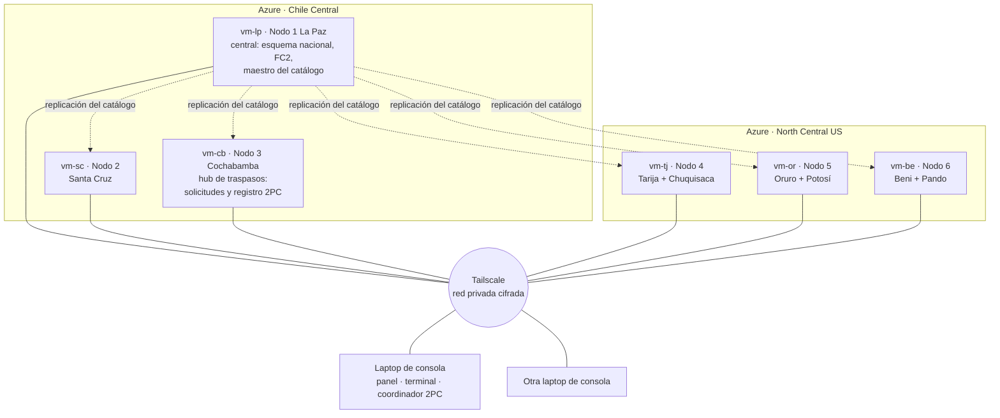

<div align="center">

# SGBDD · BoliviaDistribución S.A.

**Sistema de Base de Datos Distribuida para la gestión logística nacional**

Seis servidores PostgreSQL 16, uno por región, forman una sola base de datos lógica: fragmentación
horizontal y vertical, replicación del catálogo, consultas transparentes y traspasos entre sucursales
con compromiso en dos fases (2PC).


[](https://github.com/CondoriEstherD/distributed-db-bolivia/actions/workflows/pruebas.yml)

</div>

---

## Contenido

- [Qué hace el sistema](#qué-hace-el-sistema)
- [Arquitectura](#arquitectura)
- [Diseño de distribución](#diseño-de-distribución)
- [Tecnologías](#tecnologías)
- [Preparar una laptop](#preparar-una-laptop) ← **empiece aquí**
- [Uso diario](#uso-diario)
- [El panel web](#el-panel-web)
- [La terminal](#la-terminal)
- [Pruebas](#pruebas)
- [Despliegue](#despliegue)
- [Estructura del repositorio](#estructura-del-repositorio)
- [Solución de problemas](#solución-de-problemas)
- [Documentación](#documentación)

---

## Qué hace el sistema

BoliviaDistribución S.A. es una distribuidora de **cosméticos y cuidado personal** con sucursales en
los nueve departamentos. El sistema cumple dos requisitos que se contradicen en una base centralizada:

- **Cada sucursal vende aunque pierda la conexión** con las demás (autonomía local).
- **La oficina central de La Paz consulta todo el país** como si fuera una sola base (transparencia).

| Funcionalidad | Cómo se logra |
|---|---|
| Cada sucursal guarda solo sus ventas, clientes e inventario | Fragmentación horizontal por departamento (y derivada para detalles e inventario) |
| Los datos de crédito de los clientes solo existen en La Paz | Fragmentación vertical: FC1 (datos generales) en cada sucursal, FC2 (financieros) solo en La Paz |
| Mismos productos y precios en todas las sucursales | Replicación lógica del catálogo desde La Paz |
| `SELECT * FROM ventas_nacionales` sin saber dónde están los datos | Esquema `nacional` con particiones remotas (`postgres_fdw`) |
| Mover mercadería entre sucursales sin perderla ni duplicarla | Solicitud del origen, aceptación del destino y **2PC** entre las dos bases |
| Si una sucursal cae, las demás siguen | Tiempos límite, consulta tolerante a fallos y recuperación del 2PC |

## Arquitectura



| Nodo | Servidor | Departamentos | Puerto | Ventas de prueba |
|---|---|---|---|---:|
| 1 · Central | `vm-lp` | La Paz | 15431 | 12 500 |
| 2 | `vm-sc` | Santa Cruz | 15432 | 15 000 |
| 3 · Hub de traspasos | `vm-cb` | Cochabamba | 15433 | 10 000 |
| 4 | `vm-tj` | Tarija, Chuquisaca | 15434 | 5 000 |
| 5 | `vm-or` | Oruro, Potosí | 15435 | 5 000 |
| 6 | `vm-be` | Beni, Pando | 15436 | 2 500 |
| | | | **Total** | **50 000** |

Cada servidor ejecuta un contenedor Docker con PostgreSQL 16. Ninguno expone puertos a internet: solo
se alcanzan dentro de la red Tailscale. Las **laptops no guardan datos**: son consolas que se conectan
a los servidores, y pueden trabajar varias a la vez.

## Diseño de distribución

| Técnica | Relación | Implementación |
|---|---|---|
| Fragmentación horizontal primaria | `ventas`, `almacenes`, `clientes_datos_generales` | Predicado `departamento_id IN (…)` por nodo, garantizado con `CHECK` |
| Fragmentación horizontal derivada | `detalle_venta ⋉ ventas`, `inventario ⋉ almacenes` | Cada detalle vive en el nodo de su venta o almacén |
| Fragmentación vertical | `clientes` | FC1 `clientes_datos_generales` (nodos 1–6) · FC2 `clientes_financiero` (solo La Paz) |
| Replicación total | `productos_catalogo` | Publicación en La Paz, suscripción en los nodos 2–6 |
| Identificadores globales | todas | Rango por nodo: `nodo × 10⁹ + n` (ventas, clientes) y `nodo × 100 + k` (almacenes) |
| Transparencia | esquema `nacional` | `PARTITION BY LIST` con particiones remotas: poda de fragmentos y agregación en cada nodo |
| Transacciones distribuidas | `inventario` | Aprobación de dos encargados + 2PC con registro en Cochabamba, orden fijo de bloqueos y recuperación por presunción de aborto |
| Seguridad | todas | Matriz CRUD con `GRANT/REVOKE`, mínimo privilegio, SCRAM, solo red privada; panel con contraseña por sucursal |

## Tecnologías

| Capa | Herramienta | Uso |
|---|---|---|
| Base de datos | PostgreSQL 16 | `postgres_fdw`, replicación lógica, `PREPARE TRANSACTION`, particionamiento |
| Servidores | Azure (6 VMs Ubuntu 24.04) + Docker | Un servidor y un contenedor por nodo |
| Red | Tailscale | Red privada cifrada entre los servidores y las laptops |
| Lógica distribuida | Python 3.12 + psycopg 3 | Coordinador 2PC, recuperación, operación de nodos |
| API | FastAPI + Uvicorn | Expone las operaciones al panel; cada respuesta incluye el SQL ejecutado |
| Panel | React + TypeScript + Tailwind + shadcn/ui | Punto de venta por sucursal y administración central |

---

## Preparar una laptop

Cada integrante prepara su laptop **una sola vez**. Al terminar puede usar el panel y la terminal
contra los servidores de Azure. No hace falta instalar Docker ni Node.

### 1. Instalar los programas

| Programa | Dónde | Detalle |
|---|---|---|
| **Git** | https://git-scm.com/download/win | Instalación por defecto |
| **Python 3.12 o superior** | https://www.python.org/downloads/ | En el instalador, marque **«Add python.exe to PATH»** |
| **Tailscale** | https://tailscale.com/download/windows | Inicie sesión con la **cuenta del grupo** (la misma de los servidores) |

Compruebe en PowerShell:

```powershell
git --version
python --version          # 3.12 o superior
tailscale status          # debe listar vm-lp, vm-sc, vm-cb, vm-tj, vm-or y vm-be
```

> [!IMPORTANT]
> Todos deben usar la **misma cuenta de Tailscale del grupo**. Con otra cuenta, la laptop no ve los
> servidores o no puede entrar a ellos para provocar fallas.

### 2. Descargar el proyecto

```powershell
cd $HOME\Documents
git clone https://github.com/CondoriEstherD/distributed-db-bolivia.git sgbdd
cd sgbdd
python -m venv .venv
.\.venv\Scripts\pip install -r requirements.txt
```

### 3. Copiar la configuración (`.env`)

El archivo `.env` tiene las direcciones de los 6 servidores y **todas las contraseñas**. No está en
GitHub: pídalo a la persona que hizo el despliegue y cópielo en la carpeta `sgbdd`.

> [!CAUTION]
> Pase el `.env` por USB o mensaje privado, **nunca** por GitHub ni por un grupo público.

Revise que tenga estas líneas (las IP son ejemplos):

```ini
MODO=red
NODOS_LOCALES=                 # vacío: la laptop no aloja nodos
HOST_LP=100.x.y.z              # … y HOST_SC, HOST_CB, HOST_TJ, HOST_OR, HOST_BE
CLAVE_LP=…                     # contraseñas del panel: CLAVE_LP … CLAVE_BE
```

### 4. Comprobar

```powershell
.\.venv\Scripts\python.exe gestion.py estado
```

Los 6 nodos deben aparecer **EN LÍNEA**. Si aparecen SIN CONEXIÓN, las VMs están apagadas (ver
[Uso diario](#uso-diario)).

### 5. Abrir el panel

Doble clic en **`abrir_panel.bat`**. Se abre el navegador en http://localhost:8000: elija su sucursal
y escriba su contraseña. No cierre la ventana negra mientras use el panel.

Para recibir las mejoras del proyecto, ejecute `git pull` en la carpeta `sgbdd` antes de trabajar.

<details>
<summary><b>macOS o Linux</b></summary>

Los comandos son los mismos cambiando `.\.venv\Scripts\python.exe` por `.venv/bin/python`. En lugar
de `abrir_panel.bat`:

```bash
.venv/bin/python -m uvicorn api.main:app --port 8000
```

</details>

---

## Uso diario

1. **Encender los servidores** (una persona, en la Cloud Shell del portal de Azure, Bash):
   ```bash
   az vm start --ids $(az vm list -g rg-sgbdd --query [].id -o tsv)
   ```
2. **Comprobar** desde cualquier laptop: `.\.venv\Scripts\python.exe gestion.py estado`.
3. **Trabajar** con el panel (`abrir_panel.bat`) o la terminal.
4. **Al terminar**: dejar todo en orden y **apagar los servidores** (no cobran mientras están apagados):
   ```powershell
   .\.venv\Scripts\python.exe gestion.py restablecer
   ```
   ```bash
   az vm deallocate --ids $(az vm list -g rg-sgbdd --query [].id -o tsv)
   ```

> [!WARNING]
> Las VMs de Chile Central no se apagan solas. Si quedan encendidas, consumen el crédito de Azure.

---

## El panel web

**Ingreso:** cada sucursal entra con su propia contraseña (`CLAVE_XX` del `.env`) y solo ve sus datos.
**La Paz** entra además a la **administración central**.

| Sucursal | Qué se hace | Qué demuestra |
|---|---|---|
| **Vender** | Catálogo con fotos, carrito y cobro | Venta 100 % local: funciona aunque la sucursal pierda la red |
| **Historial de ventas** | Sus ventas y el comprobante de cada una | Fragmentos FV (ventas) y FDV (detalle) de esa sucursal |
| **Clientes** | Datos generales de sus clientes | Fragmento vertical FC1 |
| **Inventario** | Stock de sus almacenes | Fragmento derivado FI: cada sucursal tiene su propio stock |
| **Traspasos** | Solicitar, recibir (aceptar o rechazar) y seguir traspasos | Doble aprobación + 2PC entre dos bases |

| Administración central (La Paz) | Qué demuestra |
|---|---|
| **Panorama nacional** | Estado de los 6 servidores y ventas por departamento |
| **Clientes y crédito** | Reconstrucción vertical FC1 ⋈ FC2 |
| **Catálogo y precios** | Replicación: un precio cambiado en La Paz llega en vivo a las sucursales |
| **Consultas distribuidas** | Transparencia y poda de fragmentos (plan de ejecución) |
| **Auditoría de traspasos** | Registro de decisiones del 2PC y recuperación de transacciones en duda |
| **Simulación de fallas** | Cortar la red o apagar una sucursal y comprobar qué sigue funcionando |

Detalle de cada pantalla y de cómo usar varias laptops en la defensa:
[`docs/MANUAL_OPERACION.md`](docs/MANUAL_OPERACION.md).

---

## La terminal

Desde la carpeta del proyecto (`py` = `.\.venv\Scripts\python.exe`). Los comandos sobre un nodo se
ejecutan en el servidor de ese nodo por SSH, como lo haría su operador.

| Tarea | Comando |
|---|---|
| Estado de los 6 nodos | `py gestion.py estado` |
| Cortar la red de una sucursal (sigue vendiendo) | `py gestion.py aislar be` |
| Restablecer la red | `py gestion.py reconectar be` |
| Apagar / encender el servidor de base de datos | `py gestion.py apagar be` · `py gestion.py encender be` |
| Dejar todo en operación normal | `py gestion.py restablecer` |
| Venta en la terminal local de una sucursal | `py gestion.py vender be` |
| SQL en un nodo | `py gestion.py sql lp "SELECT * FROM nacional.resumen_nacional_disponible()"` |
| Traspaso con 2PC (protocolo de las bases) | `py -m sgbdd.coordinador_2pc --origen 201 --destino 601 --producto 15 --cantidad 5` |
| … con pausa para cortar la red a mitad | añadir `--pausa 15` |
| Resolver transacciones en duda | `py gestion.py recuperar --edad-minima 0` |
| Pruebas automáticas | `py -m pruebas.ejecutar_pruebas` |

Guía completa con los escenarios del 2PC paso a paso: [`docs/MANUAL_OPERACION.md`](docs/MANUAL_OPERACION.md).

---

## Pruebas

```powershell
py -m pruebas.ejecutar_pruebas          # los 14 casos (aíslan y apagan Beni y la dejan como estaba)
py -m pruebas.ejecutar_pruebas P7 P8    # casos concretos
```

Resultado en Azure: **14/14** ([evidencia](docs/evidencias/pruebas_azure.txt)). GitHub Actions corre
los mismos casos en modo laboratorio y compila el panel en cada cambio a `main`.

| Caso | Escenario | Resultado en Azure |
|---|---|---|
| P0 | Reglas de corrección de la fragmentación | 50 000+ ventas en 9 departamentos, 0 duplicados, 0 huérfanos |
| P1 | Autonomía local con Beni aislada | Beni vende sin red |
| P2 | Consulta nacional con un nodo caído | Error controlado en 6,6 s, sin bloqueo |
| P3 | Eliminación de fragmentos | Consultar Santa Cruz no toca a Beni |
| P4 | Consulta tolerante a fallos | Resumen parcial que marca `fv6_be` FUERA DE LÍNEA |
| P5 | Consistencia eventual del catálogo | Santa Cruz recibe el precio en 0,6 s; Beni aislada conserva el anterior |
| P6 | Sincronización diferida | Beni se pone al día 3 s después de reconectarse |
| P7 | Traspaso 2PC exitoso | Confirmado en ambas; stock nacional sin cambio |
| P8 | Beni cae a mitad del 2PC | Rollback automático en Santa Cruz |
| P9 | Cae el coordinador | La recuperación confirma o deshace según el registro |
| P10 | 20 traspasos simultáneos | El stock nunca baja de 0; total nacional conservado |
| P11 | Seguridad (matriz CRUD) | 5/5 accesos prohibidos rechazados |
| P12 | Cae La Paz | Las demás sucursales siguen vendiendo |
| P13 | Beni apagada | Las demás venden; al volver recibe los cambios pendientes |

Informe completo: [`docs/INFORME_PRUEBAS.md`](docs/INFORME_PRUEBAS.md).

---

## Despliegue

| Modo | Dónde corren los 6 nodos | Guía |
|---|---|---|
| **Azure** (principal) | Una VM por sucursal, en dos regiones | [`docs/DESPLIEGUE_AZURE.md`](docs/DESPLIEGUE_AZURE.md): un script en la Cloud Shell crea y configura todo en 10-15 min |
| **Laboratorio** | Los 6 contenedores en una sola PC con Docker Desktop | Abajo |
| **7 laptops** (plan B sin nube) | Un nodo por laptop de cada integrante | [`docs/DESPLIEGUE_RED.md`](docs/DESPLIEGUE_RED.md) |

**Modo laboratorio** (requiere Docker Desktop):

```powershell
Copy-Item .env.example .env            # MODO=lab: los 6 nodos en esta PC
.\.venv\Scripts\python.exe gestion.py levantar     # 1-3 min la primera vez
.\.venv\Scripts\python.exe gestion.py configurar
.\.venv\Scripts\python.exe gestion.py estado
```

El mismo código funciona en los tres modos; solo cambia el `.env`.

---

## Estructura del repositorio

```
├── abrir_panel.bat             abre el panel (doble clic)
├── gestion.py                  consola de operación de los nodos
├── requirements.txt            dependencias de Python
├── .env.example                plantilla de configuración (el .env real no se sube)
├── docker-compose.yml          un contenedor PostgreSQL 16 por nodo
├── api/main.py                 API del panel (FastAPI)
├── sgbdd/
│   ├── config.py               topología (lee .env) y conexión a los nodos
│   ├── operacion.py            levantar, configurar, estado, fallas (local o por SSH)
│   ├── coordinador_2pc.py      protocolo de compromiso en dos fases
│   └── recuperacion_2pc.py     resolución de transacciones en duda
├── sql/
│   ├── comun/                  roles, esquema y fragmentos, catálogo, datos, funciones, permisos
│   ├── nodo1_lp/               La Paz: FC2, publicación del catálogo, esquema nacional, vistas
│   ├── nodo3_cb/               Cochabamba: registro del 2PC y solicitudes de traspaso
│   ├── replicas/               suscripción al catálogo de los nodos 2-6
│   └── consultas/              consultas distribuidas de referencia C1-C8
├── web/                        panel React (src/) y su versión compilada (dist/)
├── docker/
│   ├── initdb/                 inicialización de cada nodo
│   ├── pg_hba.conf             acceso solo desde redes privadas
│   └── vps/                    despliegue en Azure (script, preparación de VM, servicio del panel)
├── pruebas/                    casos P0-P13 y medición de latencia
├── docs/                       manuales, guías de despliegue, informe de pruebas, evidencias
└── .github/workflows/          integración continua
```

---

## Solución de problemas

| Síntoma | Solución |
|---|---|
| `estado` muestra un nodo SIN CONEXIÓN | La VM está apagada o sin Tailscale: Cloud Shell `az vm start -g rg-sgbdd -n vm-xx`, o portal → vm-xx → Ejecutar comando → `tailscale up` |
| Todos los nodos SIN CONEXIÓN | Su laptop no está en Tailscale (`tailscale status`) o las VMs están apagadas |
| `aislar`, `apagar` o `vender` se quedan esperando | Tailscale pide verificación SSH: en su consola, ACL → bloque `ssh` → `"action": "accept"` |
| `ssh: … Connection timed out` | La VM de ese nodo no está en la red (mismo arreglo que SIN CONEXIÓN) |
| `python` no se reconoce | Reinstale Python marcando «Add python.exe to PATH» y abra otra PowerShell |
| El panel pide contraseña y no la acepta | Use la `CLAVE_XX` de su sucursal en el `.env` |
| El panel no muestra un cambio reciente | Ctrl + F5 en el navegador; `git pull` y reabra `abrir_panel.bat` |
| `recuperar` dice que Cochabamba no responde | La recuperación decide con el registro del Nodo 3: `py gestion.py restablecer cb` |
| Quedó un nodo aislado o apagado tras una prueba | `py gestion.py restablecer` |

---

## Documentación

| Documento | Contenido |
|---|---|
| [Manual de operación](docs/MANUAL_OPERACION.md) | Varias laptops, panel y terminal paso a paso |
| [Despliegue en Azure](docs/DESPLIEGUE_AZURE.md) | Crear y configurar las 6 VMs; uso diario y costos |
| [Guion de la defensa](docs/GUION_DEFENSA.md) | Los 15 minutos de la presentación |
| [Informe de pruebas](docs/INFORME_PRUEBAS.md) | Casos P0-P13 en laboratorio y en Azure |
| [Especificación técnica](docs/Especificacion_Tecnica_SGBDD_BoliviaDistribucion.docx) | Documento formal del diseño (APA 7) |
| [Plan de implementación](docs/PLAN_IMPLEMENTACION.md) · [Tareas del equipo](docs/TAREAS_EQUIPO.md) | Planificación y reparto del trabajo |
| [Despliegue en 7 laptops](docs/DESPLIEGUE_RED.md) | Plan B sin nube |
| [Panel web](web/README.md) | Cómo modificar el frontend |

**Fotos de productos:** Wikimedia Commons, licencias libres; autores y licencias en
[`web/public/productos/CREDITOS.md`](web/public/productos/CREDITOS.md). Las marcas pertenecen a sus
dueños y se usan solo para ilustrar un proyecto académico.

### Referencias

Özsu, M. T., y Valduriez, P. (2020). *Principles of distributed database systems* (4.ª ed.). Springer.

PostgreSQL Global Development Group. (2024). *PostgreSQL 16 documentation*. https://www.postgresql.org/docs/16/

---

<div align="center"><sub>Proyecto académico · Bases de Datos Distribuidas · 2026</sub></div>
