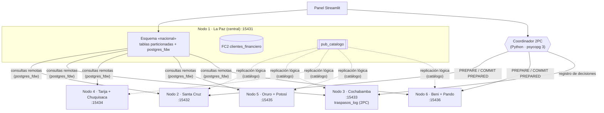
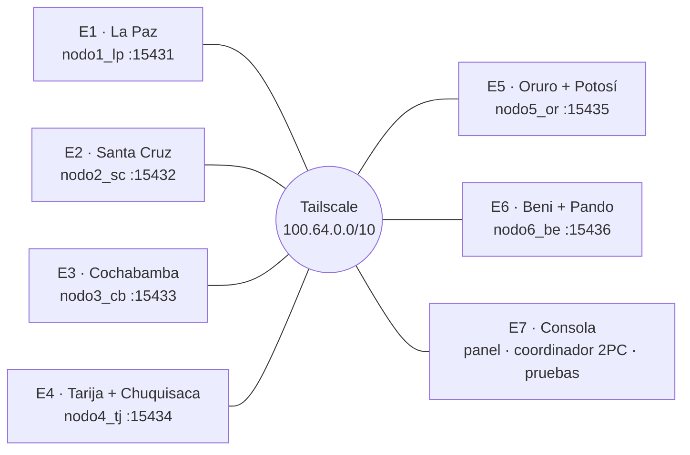

<div align="center">

# SGBDD · BoliviaDistribución S.A.

**Sistema de Base de Datos Distribuida para la gestión logística nacional**

Seis nodos PostgreSQL 16 (un contenedor por nodo) con fragmentación horizontal, derivada y vertical,
replicación lógica, transparencia de distribución y transacciones distribuidas con compromiso en dos fases.


[](https://github.com/CondoriEstherD/distributed-db-bolivia/actions/workflows/pruebas.yml)

</div>

---

## Contenido

1. [Descripción](#1-descripción)
2. [Arquitectura](#2-arquitectura)
3. [Diseño de distribución](#3-diseño-de-distribución)
4. [Tecnologías](#4-tecnologías)
5. [Inicio rápido](#5-inicio-rápido)
6. [Demostración](#6-demostración)
7. [Pruebas](#7-pruebas)
8. [Operación](#8-operación)
9. [Despliegue en varios equipos](#9-despliegue-en-varios-equipos)
10. [Estructura del repositorio](#10-estructura-del-repositorio)
11. [Solución de problemas](#11-solución-de-problemas)
12. [Documentación](#12-documentación)

---

## 1. Descripción

BoliviaDistribución S.A. opera sucursales en los nueve departamentos del país. Cada sucursal debe
**vender aunque pierda la conexión con la oficina central**, mientras que la gerencia en La Paz necesita
**consultas nacionales como si existiera una sola base de datos**.

El sistema resuelve ese requisito con un diseño distribuido descendente (Özsu y Valduriez, 2020):

- Cada nodo guarda solo los datos de sus departamentos (**autonomía local**).
- La Paz ve todos los fragmentos mediante un esquema global (**transparencia**).
- El catálogo se replica de forma asíncrona (**disponibilidad**).
- Los traspasos de inventario entre nodos usan 2PC (**consistencia**).

## 2. Arquitectura



| Nodo | Contenedor | Departamentos | Puerto | Ventas de prueba |
|---|---|---|---|---:|
| 1 · Central | `nodo1_lp` | La Paz | 15431 | 12 500 |
| 2 | `nodo2_sc` | Santa Cruz | 15432 | 15 000 |
| 3 | `nodo3_cb` | Cochabamba | 15433 | 10 000 |
| 4 | `nodo4_tj` | Tarija, Chuquisaca | 15434 | 5 000 |
| 5 | `nodo5_or` | Oruro, Potosí | 15435 | 5 000 |
| 6 | `nodo6_be` | Beni, Pando | 15436 | 2 500 |
| | | | **Total** | **50 000** |

## 3. Diseño de distribución

| Técnica | Relación | Implementación |
|---|---|---|
| Fragmentación horizontal primaria | `ventas`, `almacenes` | Predicado `departamento_id IN (…)` por nodo, garantizado con `CHECK` |
| Fragmentación horizontal derivada | `detalle_venta ⋉ ventas`, `inventario ⋉ almacenes` | Cada detalle vive en el nodo de su venta o almacén |
| Fragmentación vertical | `clientes` | FC1 `clientes_datos_generales` (nodos 1–6) · FC2 `clientes_financiero` (solo La Paz) |
| Replicación total | `productos_catalogo` | Publicación en La Paz, suscripción en nodos 2–6 |
| Identificadores globales | todas | Rango por nodo: `nodo × 10⁹ + n` (ventas, clientes) y `nodo × 100 + k` (almacenes) |
| Transparencia | esquema `nacional` | `PARTITION BY LIST` con particiones remotas: poda de fragmentos y agregación en cada nodo |
| Transacciones distribuidas | `inventario` | 2PC con registro en Cochabamba, orden fijo de bloqueos y recuperación por presunción de aborto |
| Seguridad | todas | Matriz CRUD con `GRANT/REVOKE`, mínimo privilegio, SCRAM, solo redes privadas |

Las reglas de corrección de la fragmentación (completitud, reconstrucción y disyunción) se verifican
automáticamente en la prueba P0.

## 4. Tecnologías

| Capa | Herramienta | Uso |
|---|---|---|
| Motor | PostgreSQL 16 | `postgres_fdw`, replicación lógica, `PREPARE TRANSACTION`, particionamiento |
| Infraestructura | Docker Compose | Un contenedor por nodo, red `sgbdd_wan` |
| Red entre equipos | Tailscale (gratuito) | Red privada cifrada sin exponer puertos a Internet |
| Coordinación | Python 3.12 + psycopg 3 | Coordinador 2PC, recuperación, consola de operación |
| Interfaz | Streamlit | Panel de demostración: cada acción muestra su SQL |
| Administración (opcional) | pgAdmin 4 | Exploración visual de los nodos |

## 5. Inicio rápido

**Requisitos:** Docker Desktop (en Windows, con WSL2) y Python 3.12 o superior.

```powershell
git clone https://github.com/CondoriEstherD/distributed-db-bolivia.git
cd distributed-db-bolivia

python -m venv .venv
.venv\Scripts\activate
pip install -r requirements.txt

python gestion.py levantar      # crea .env, levanta los 6 nodos y carga los datos (1-3 min la primera vez)
python gestion.py configurar    # suscripciones al catálogo + esquema «nacional» en La Paz
python gestion.py estado        # salud, volumen y replicación de cada nodo
```

> [!IMPORTANT]
> Cambie `PG_PASSWORD` y `APP_PASSWORD` en `.env` antes de cualquier despliegue en red.
> El archivo `.env` está excluido del repositorio.

## 6. Demostración

```powershell
streamlit run dashboard/app.py   # http://localhost:8501
```

| Página | Qué demuestra |
|---|---|
| Panorama nacional | Estado de los 6 nodos, ventas por departamento y diseño de distribución |
| Consultas distribuidas | Consultas C1–C8 desde La Paz; el plan `EXPLAIN` muestra qué fragmentos se consultaron |
| Venta local | Transacción 100 % local, que funciona con el nodo aislado |
| Traspaso 2PC | Fases del protocolo paso a paso, stock antes y después y registro de decisiones |
| Replicación del catálogo | Cambio de precio en La Paz y su propagación en vivo a cada nodo |
| Simulación de fallas | Cortar el enlace o apagar el servidor de un nodo y verificar consultas y ventas |
| Recuperación 2PC | Hacer caer el coordinador a mitad del traspaso y resolver las transacciones en duda |

### Cómo probar la caída de un nodo

**Desde el panel:** página *Simulación de fallas* → elegir el nodo y el tipo de falla → **Provocar falla** →
pulsar **Probar** en cada verificación → **Restaurar nodo**.

**Desde la consola:**

```powershell
python gestion.py aislar be      # caída del ENLACE: Beni sigue vendiendo localmente
python gestion.py vender be      # funciona (autonomía local)
python gestion.py sql lp "SELECT * FROM nacional.resumen_nacional_disponible()"   # informa fv6_be FUERA DE LÍNEA
python gestion.py reconectar be

python gestion.py apagar be      # caída TOTAL del servidor: Beni no atiende ni localmente
python gestion.py vender sc      # los demás nodos siguen vendiendo
python gestion.py encender be    # vuelve y la réplica del catálogo se pone al día sola
```

## 7. Pruebas

```powershell
python -m pruebas.ejecutar_pruebas          # todos los casos
python -m pruebas.ejecutar_pruebas P7 P10   # casos concretos
python -m pruebas.test_panel                # el panel: 7 páginas, 8 consultas, fallas y recuperación
```

GitHub Actions (`.github/workflows/pruebas.yml`) levanta los 6 nodos y corre ambas suites en cada *push* y
*Pull Request* a `main`; si algo falla, guarda los registros de los nodos como *artifact*.

En modo `lab` corren los 14 casos. En modo `red` (desde el equipo de consola) corren P0, P7, P9, P10 y
P11; los casos de fallas se demuestran cortando el enlace real del equipo (ver sección 9).

| Caso | Escenario | Resultado medido |
|---|---|---|
| P0 | Reglas de corrección de la fragmentación | 50 000 ventas en 9 departamentos, sin duplicados |
| P1 | Autonomía local con Beni aislado | Beni sigue registrando ventas |
| P2 | Consulta global con un nodo caído | Error controlado en 4,1 s |
| P3 | Eliminación de fragmentos con un nodo caído | Las consultas que no lo requieren siguen funcionando |
| P4 | Consulta tolerante a fallos | Resumen parcial que indica el fragmento caído |
| P5 | Consistencia eventual del catálogo | Propagación en 0,2 s |
| P6 | Sincronización diferida al reconectar | Beni se pone al día 2,9 s después de reconectarse |
| P7 | Traspaso 2PC exitoso SC → BE | Confirmado en ambos nodos |
| P8 | Caída del destino durante el 2PC | Rollback: el origen queda intacto |
| P9 | Caída del coordinador | La recuperación confirma o deshace según el registro |
| P10 | 20 traspasos simultáneos sobre 100 unidades | 10 confirmados, stock nunca negativo, total nacional conservado |
| P11 | Seguridad: matriz CRUD | 4/4 operaciones prohibidas rechazadas por el gestor |
| P12 | Caída del nodo central | Los demás nodos siguen vendiendo |
| P13 | Caída total de Beni (servidor apagado) | Los demás venden; al encenderlo recibe los cambios pendientes del catálogo |

## 8. Operación

| Tarea | Comando |
|---|---|
| Estado de los nodos | `python gestion.py estado` |
| Cortar el enlace WAN de un nodo (sigue operando local) | `python gestion.py aislar be` |
| Restablecer el enlace | `python gestion.py reconectar be` |
| Apagar el servidor de un nodo (caída total) | `python gestion.py apagar be` |
| Volver a encender el nodo | `python gestion.py encender be` |
| Venta en la consola local de un nodo | `python gestion.py vender be` |
| SQL en un nodo | `python gestion.py sql lp "SELECT * FROM nacional.resumen_nacional_disponible()"` |
| Traspaso 2PC | `python -m sgbdd.coordinador_2pc --origen 201 --destino 601 --producto 15 --cantidad 50` |
| Traspaso con pausa (para cortar un enlace a mitad) | añadir `--pausa 10` |
| Resolver transacciones en duda | `python gestion.py recuperar` |
| pgAdmin (http://localhost:5050) | `python gestion.py levantar --admin` |
| Borrar todo y empezar de cero | `python gestion.py reiniciar --si` |

Identificadores útiles: almacenes `101-102` LP, `201-202` SC, `301-302` CB, `401-404` TJ/CH,
`501-504` OR/PO, `601-604` BE/PA. Productos: 1 a 200. Los ids de ventas y clientes empiezan con el número
del nodo que los creó (`6000002501` → Beni).

## 9. Despliegue en varios equipos

Los mismos scripts funcionan en una laptop (modo `lab`) o en siete (modo `red`); solo cambia `.env`.
En modo red cada nodo vive en su propio equipo, como una sucursal real, y un séptimo equipo actúa como
**consola de operación**: no aloja nodos, solo se conecta a ellos.



| Equipo | Aloja | `NODOS_LOCALES` | Necesita |
|---|---|---|---|
| E1 | Nodo 1 · La Paz (esquema `nacional`, FC2, publicación del catálogo) | `lp` | Docker, Python, Tailscale, puerto 15431 abierto |
| E2 | Nodo 2 · Santa Cruz | `sc` | Docker, Python, Tailscale, puerto 15432 abierto |
| E3 | Nodo 3 · Cochabamba (registro `traspasos_log` del 2PC) | `cb` | Docker, Python, Tailscale, puerto 15433 abierto |
| E4 | Nodo 4 · Tarija y Chuquisaca | `tj` | Docker, Python, Tailscale, puerto 15434 abierto |
| E5 | Nodo 5 · Oruro y Potosí | `or` | Docker, Python, Tailscale, puerto 15435 abierto |
| E6 | Nodo 6 · Beni y Pando | `be` | Docker, Python, Tailscale, puerto 15436 abierto |
| E7 | Consola: panel Streamlit, coordinador 2PC, recuperación y pruebas | *(vacío)* | Python y Tailscale (Docker no es necesario) |

Ventajas de la consola separada: cuando se corta el enlace de cualquier nodo (incluido La Paz), el panel
y el coordinador siguen funcionando y muestran la falla en vivo. Además, el coordinador 2PC no comparte
equipo con ningún participante, como en una arquitectura real.

### Pasos

1. **Tailscale.** Instalarlo en los 7 equipos e iniciar sesión con **una misma cuenta del grupo**
   (el plan gratuito admite hasta 100 dispositivos). Anotar la IP de cada equipo con `tailscale ip -4`.
2. **Repositorio.** Clonarlo en los 7 equipos (sección 5).
3. **`.env`.** Debe ser **idéntico en los 7 equipos** (mismas contraseñas, mismas IP y puertos), salvo
   `NODOS_LOCALES`. Ejemplo para E2:
   ```ini
   PG_PASSWORD=<la misma en todos>
   APP_PASSWORD=<la misma en todos>
   MODO=red
   NODOS_LOCALES=sc          # E1=lp · E3=cb · E4=tj · E5=or · E6=be · E7 vacío
   BIND_IP=0.0.0.0
   HOST_LP=100.64.0.1        # IP de Tailscale de E1
   HOST_SC=100.64.0.2        # IP de Tailscale de E2
   HOST_CB=100.64.0.3
   HOST_TJ=100.64.0.4
   HOST_OR=100.64.0.5
   HOST_BE=100.64.0.6
   # PORT_LP … PORT_BE se mantienen: 15431 … 15436
   ```
4. **Firewall (E1 a E6).** Abrir solo el puerto del nodo propio, en PowerShell como administrador
   (ejemplo para E2):
   ```powershell
   New-NetFirewallRule -DisplayName "SGBDD nodo" -Direction Inbound -Protocol TCP -LocalPort 15432 -Action Allow
   ```
5. **Levantar (E1 a E6).** `python gestion.py levantar` en cada equipo. Cada nodo carga solo sus datos.
6. **Conectividad.** Desde E7, comprobar los 6 puertos:
   ```powershell
   Test-NetConnection 100.64.0.2 -Port 15432
   ```
   Desde E1, comprobar que el **contenedor** de La Paz llega a los demás nodos (lo usa `postgres_fdw`):
   ```powershell
   docker exec nodo1_lp pg_isready -h 100.64.0.2 -p 15432
   ```
7. **Configurar, en este orden.** Primero E2 a E6 (`python gestion.py configurar`: suscripción al
   catálogo) y **al final E1** (crea el esquema `nacional` y carga FC2 leyendo los 6 nodos; si algún nodo
   está apagado, avisa y basta repetirlo).
8. **Verificar desde E7.** `python gestion.py estado` debe mostrar los 6 nodos en línea y la replicación
   activa. Luego, `python -m pruebas.ejecutar_pruebas` y `streamlit run dashboard/app.py`.

### Diferencias del modo red

| Aspecto | Modo `lab` (1 equipo) | Modo `red` (7 equipos) |
|---|---|---|
| Cortar el enlace de un nodo | `python gestion.py aislar be` o el panel | `tailscale down` en el equipo del nodo (`tailscale up` para volver) |
| Apagar un nodo | `python gestion.py apagar be` o el panel | `python gestion.py apagar be` **en el equipo del nodo** |
| Venta con el nodo aislado | `python gestion.py vender be` desde cualquier lugar | `python gestion.py vender be` **en el equipo del nodo** |
| Pruebas automáticas | P0–P13 | P0, P7, P9, P10 y P11 desde E7; los casos de fallas (P1–P6, P8, P12, P13) se demuestran a mano con `tailscale down` |
| Cambios en `sql/comun` | `python gestion.py reiniciar --si` | `reiniciar --si` en cada equipo afectado y repetir los pasos 5 a 7 |

> [!WARNING]
> - El **equipo de cada nodo debe permanecer encendido**: si se apaga o suspende, ese fragmento queda
>   fuera de línea y las consultas nacionales que lo necesitan fallan (de forma controlada).
>   Desactivar la suspensión durante la demostración.
> - Si un equipo cambia de IP de Tailscale, hay que actualizar `.env` en los 7 equipos y repetir el paso 7.
> - Cada equipo de nodo necesita unos 2 GB de RAM libres (Docker Desktop + un PostgreSQL).
> - **Respaldo:** si un equipo falla el día de la defensa, cualquier otro puede alojar ese nodo
>   (agregarlo a su `NODOS_LOCALES` y cambiar su `HOST_*` en todos). Como último recurso, el modo
>   `lab` levanta los 6 nodos en una sola laptop.

## 10. Estructura del repositorio

```
├── docker-compose.yml          6 nodos PostgreSQL 16 (+ pgAdmin opcional)
├── .env.example                credenciales y topología (copiar a .env)
├── docker/
│   ├── initdb/                 script de inicialización de cada nodo
│   └── pg_hba.conf             acceso solo desde redes privadas, SCRAM
├── sql/
│   ├── comun/                  01 roles · 02 esquema y fragmentos · 03 catálogo · 04 datos · 05 funciones · 06 permisos
│   ├── nodo1_lp/init/          FC2, roles centrales, publicación del catálogo
│   ├── nodo1_lp/post/          servidores remotos, esquema «nacional», vistas globales, datos FC2
│   ├── nodo3_cb/init/          registro de decisiones del coordinador 2PC
│   ├── replicas/post/          suscripción de los nodos 2-6
│   └── consultas/              consultas distribuidas de referencia C1-C8
├── sgbdd/
│   ├── config.py               topología (lee .env) y conexión a los nodos
│   ├── coordinador_2pc.py      protocolo de compromiso en dos fases
│   ├── recuperacion_2pc.py     resolución de transacciones en duda
│   └── operacion.py            despliegue, configuración, estado, simulación de fallas
├── gestion.py                  consola de operación
├── dashboard/                  panel de demostración (Streamlit)
│   ├── app.py                  navegación y estado de los nodos
│   ├── comun.py                utilidades compartidas
│   └── app_pages/              una página por funcionalidad
├── .streamlit/config.toml      tema visual del panel
├── pruebas/
│   ├── ejecutar_pruebas.py     casos de prueba P0-P13
│   └── test_panel.py           pruebas del panel (AppTest)
├── .github/workflows/          integración continua
└── docs/                       especificación técnica y plan de implementación
```

## 11. Solución de problemas

| Síntoma | Causa y solución |
|---|---|
| `ports are not available` al levantar | Otro programa usa el puerto: cambie `PORT_*` en `.env`. |
| Un nodo no llega a «listo» | `docker logs nodo2_sc` muestra el script SQL que falló. |
| Cambié un script de `sql/comun` y no se aplica | Solo corren con el volumen vacío: `python gestion.py reiniciar --si`. |
| `configurar` avisa «FC2 no cargado» | Algún nodo estaba caído; repita `configurar` con todos en línea. |
| Conexiones lentas en Windows | Use `127.0.0.1` en lugar de `localhost` en `HOST_*` (evita el intento por IPv6). |
| Quedan filas bloqueadas tras un fallo del coordinador | `python gestion.py recuperar` (o `--edad-minima 0`). |

## 12. Documentación

- [Especificación técnica (APA 7)](docs/Especificacion_Tecnica_SGBDD_BoliviaDistribucion.docx)
- [Plan de implementación](docs/PLAN_IMPLEMENTACION.md)

### Referencias

Özsu, M. T., y Valduriez, P. (2020). *Principles of distributed database systems* (4.ª ed.). Springer.

PostgreSQL Global Development Group. (2024). *PostgreSQL 16 documentation*. https://www.postgresql.org/docs/16/

---

<div align="center"><sub>Proyecto académico · Bases de Datos Distribuidas · 2026</sub></div>
