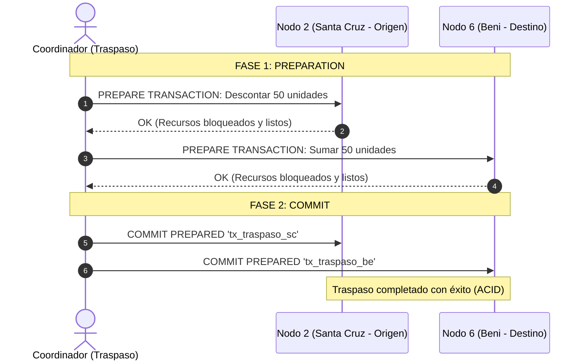
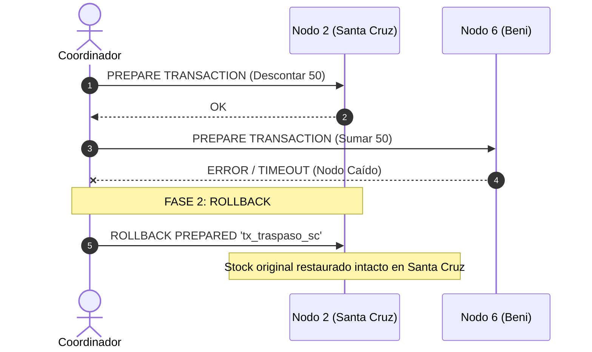

# SISTEMA DE GESTIÓN LOGÍSTICA NACIONAL "BOLIVIADISTRIBUCIÓN S.A."
## DOCUMENTO DE TRABAJO Y GUÍA TÉCNICA DE IMPLEMENTACIÓN FASE A FASE
**Sistema de Base de Datos Distribuida (SGBDD) — 6 Nodos**

---

### Ficha Técnica del Proyecto
* **Materia:** Base de Datos II / Sistemas Distribuidos
* **Empresa:** BoliviaDistribución S.A.
* **Modelo:** Arquitectura Distribuida con 6 Nodos Departamentales
* **Motor:** PostgreSQL 16 con `postgres_fdw`, Replicación Lógica y Two-Phase Commit (2PC)
* **Entornos de Despliegue:**
  1. **Modo Multi-Laptop:** Distribución en 3-4 computadoras interconectadas vía LAN/Wi-Fi (Router o Hotspot).
  2. **Modo Contenedores:** 6 nodos independientes orquestados con Docker Compose.
* **Carga de Datos:** 50,000 transacciones de ventas reales particionadas por departamento.
* **Interfaz de Demostración:** Dashboard Web local (`http://localhost:3000`) para control de fallos, vistas transparentes y 2PC en vivo.

---

## 1. Justificación y Objetivos del Proyecto

El objetivo es migrar la arquitectura centralizada hacia un **Sistema de Base de Datos Distribuida (SGBDD)** para garantizar:
1. **Autonomía Local:** Cada departamento puede vender, facturar y controlar su inventario de forma 100% independiente ante cortes de red interdepartamental.
2. **Reducción de Latencia:** Las lecturas y escrituras cotidianas se resuelven en la red local de cada nodo.
3. **Seguridad y Confidencialidad:** Separación de datos operativos públicos de los datos crediticios confidenciales.
4. **Consistencia Transaccional (ACID):** Evitar pérdidas o duplicaciones de inventario en traspasos entre regiones utilizando el protocolo Two-Phase Commit (2PC).

---

## 2. Topología Geográfica de los 6 Nodos

| Nodo | Departamento(s) | Código | Rol Estratégico | Operación Predominante |
| :--- | :--- | :--- | :--- | :--- |
| **Nodo 1** | **La Paz** | `LP` | **Nodo Central Administrativo y Consolidación** | Consultas ejecutivas nacionales, auditoría y datos financieros. |
| **Nodo 2** | **Santa Cruz** | `SC` | **Centro Logístico de Agroindustria y Retail** | Alto volumen de inserciones de ventas e inventario masivo. |
| **Nodo 3** | **Cochabamba** | `CB` | **Hub de Distribución Central y Ensamblaje** | Gestión de traspasos interdepartamentales de mercancía. |
| **Nodo 4** | **Tarija + Chuquisaca** | `TJ`, `CH` | **Sub-nodo Sur** | Operaciones comerciales regionales y despacho. |
| **Nodo 5** | **Oruro + Potosí** | `OR`, `PO` | **Sub-nodo Occidente / Minería** | Registro de importaciones, aduana interior y stock pesado. |
| **Nodo 6** | **Beni + Pando** | `BE`, `PA` | **Sub-nodo Oriente / Amazonía** | Conectividad limitada y sincronización diferida. |

---

## 3. Pilares Técnicos y Reglas de Fragmentación

### 3.1 Fragmentación Horizontal (Horizontal Partitioning)
Aplica a tablas con alto volumen transaccional para mantener los datos cerca de donde se generan.

#### Tabla `VENTAS` y `DETALLE_VENTA`:
* **Criterio:** Predicado sobre el campo `departamento_id`.
* **Reglas Formales:**
  * $F_{V1} = \sigma_{\text{departamento\_id} = 'LP'}(\text{VENTAS}) \rightarrow$ **Nodo 1 (La Paz)**
  * $F_{V2} = \sigma_{\text{departamento\_id} = 'SC'}(\text{VENTAS}) \rightarrow$ **Nodo 2 (Santa Cruz)**
  * $F_{V3} = \sigma_{\text{departamento\_id} = 'CB'}(\text{VENTAS}) \rightarrow$ **Nodo 3 (Cochabamba)**
  * $F_{V4} = \sigma_{\text{departamento\_id} \in \{'TJ','CH'\}}(\text{VENTAS}) \rightarrow$ **Nodo 4 (Tarija)**
  * $F_{V5} = \sigma_{\text{departamento\_id} \in \{'OR','PO'\}}(\text{VENTAS}) \rightarrow$ **Nodo 5 (Oruro)**
  * $F_{V6} = \sigma_{\text{departamento\_id} \in \{'BE','PA'\}}(\text{VENTAS}) \rightarrow$ **Nodo 6 (Beni)**

#### Tabla `INVENTARIO` y `ALMACENES`:
* **Criterio:** Fragmentación derivada del `id_almacen` asociado al departamento.
* **Regla:** Cada nodo almacena y gestiona exclusivamente el stock físico de sus almacenes locales.

---

### 3.2 Fragmentación Vertical (Vertical Partitioning)
Aplica sobre la entidad `CLIENTES` para desacoplar el uso operativo diario de la información financiera y de riesgo sensible.

* **Fragmento $F_{C1}$ (Datos Operativos Públicos):**
  $$\pi_{\text{id\_cliente, nit\_ci, razon\_social, telefono, direccion, departamento\_id}}(\text{CLIENTES})$$
  * **Ubicación:** Fragmentado horizontalmente en los **Nodos 1 al 6** según su `departamento_id` para permitir facturación local instantánea en cajas.
* **Fragmento $F_{C2}$ (Datos Financieros y Riesgo):**
  $$\pi_{\text{id\_cliente, limite\_credito, saldo\_pendiente, calificacion\_riesgo, estado\_credito}}(\text{CLIENTES})$$
  * **Ubicación:** Almacenado de forma **exclusiva y centralizada en el Nodo 1 (La Paz)** por auditoría bancaria y corporativa. Las sucursales no tienen acceso directo a este fragmento.

---

### 3.3 Replicación Total de Catálogo
* **Tabla:** `PRODUCTOS_CATÁLOGO` (`id_producto`, `codigo_barras`, `nombre`, `descripcion`, `precio_unitario`, `categoria`).
* **Estrategia:** Replicación Total (Full Replication) en los 6 nodos.
* **Justificación:** Lectura masiva en cada venta con baja tasa de modificación. Permite que la venta sea 100% local sin peticiones de red hacia La Paz.
* **Mecanismo:** Replicación lógica asíncrona mediante `PUBLICATION` en Nodo 1 y `SUBSCRIPTION` en Nodos 2 al 6.

---

### 3.4 Transacciones Distribuidas: Protocolo Two-Phase Commit (2PC)
Para transferir inventario entre almacenes de distintos nodos (ej. Santa Cruz $\rightarrow$ Beni):

**Si falla la conexión con Beni:**

---

## 4. Plan de Ejecución Fase a Fase

### FASE 1: Arquitectura, Modelado DDL y Fragmentación (Semana 1)
1. **Modelado Entidad-Relación Global y Esquemas Fragmentados.**
2. **Scripts DDL de Inicialización:**
   * `01_nodo1_lapaz.sql`: Tablas locales de La Paz + `CLIENTES_FINANCIERO` centralizado.
   * `02_nodo2_santacruz.sql` a `06_nodo6_beni.sql`: Tablas operativas locales con constraints `CHECK (departamento_id = '...')`.
3. **Matriz CRUD por nodo:** Mapeo de qué nodo tiene permisos de creación, lectura, actualización y eliminación sobre cada tabla.

---

### FASE 2: Despliegue de Infraestructura y Carga Masiva (Semanas 1-2)
1. **Configuración de Infraestructura:**
   * **Modo Multi-Laptop:** Configuración de `pg_hba.conf` y `postgresql.conf` (`listen_addresses = '*'`, `max_prepared_transactions = 100`, `wal_level = logical`).
   * **Modo Docker Compose:** Archivo `docker-compose.yml` que orquesta los 6 contenedores con redes virtuales y volúmenes de datos.
2. **Replicación Lógica de Catálogo:**
   * Creación de `PUBLICATION` en Nodo 1 y `SUBSCRIPTION` en Nodos 2 al 6.
3. **Carga de Datos Masivos:**
   * Script Python que genera e inyecta **mínimo 50,000 registros de ventas** con sus respectivos detalles, distribuidos proporcionalmente entre los departamentos.

---

### FASE 3: Lógica Distribuida, Transparencia y Pruebas de Estrés (Semanas 2-3)
1. **Transparencia con `postgres_fdw`:**
   * Configuración de servidores foráneos y mapeos de credenciales desde el Nodo 1 (La Paz) hacia los otros 5 nodos.
   * Vista distribuida `Ventas_Nacionales` (`UNION ALL`) para que un analista consulte todas las ventas del país en un solo comando.
   * Vista distribuida `Clientes_Completo` con `JOIN` entre datos públicos locales y datos financieros de La Paz.
2. **Procedimiento de Traspaso 2PC:**
   * Script transaccional con manejo de timeouts y cancelación automática.
3. **Pruebas de Estrés y Tolerancia a Fallos:**
   * Simulación de desconexión de red en Nodo Beni u Oruro (`docker stop` o desconectar cable/Wi-Fi).
   * Demostración de **Autonomía Local**: los demás nodos siguen operando y vendiendo con total normalidad.

---

### FASE 4: Interfaz Web de Demostración y Sustentación
1. **Dashboard Web Local (`http://localhost:3000`):**
   * Semáforo de salud de los 6 nodos en tiempo real (Verde = Online, Rojo = Offline).
   * Visor de consultas globales con gráficas interactivas por departamento.
   * Panel interactivo de traspasos 2PC con botón de inyección de error para demostrar el Rollback automático al tribunal.
2. **Guion de Sustentación:**
   * Paso a paso detallado para responder todas las preguntas del docente durante la defensa.

---

## 5. Matriz de Cumplimiento de la Rúbrica (100%)

| Criterio Evaluado | Puntos | Implementación en Nuestro Proyecto |
| :--- | :---: | :--- |
| **Diseño y Fragmentación** | **25%** | Fragmentación horizontal (`VENTAS`, `INVENTARIO`) con predicados $\sigma$ y vertical (`CLIENTES`) con proyecciones $\pi$ ajustadas a Bolivia. |
| **Autonomía Local y Transparencia** | **25%** | Nodos autónomos ante cortes de red; consultas unificadas `Ventas_Nacionales` mediante `postgres_fdw`. |
| **Transacciones y Concurrencia** | **25%** | Protocolo 2PC nativo de PostgreSQL (`PREPARE TRANSACTION`) con recuperación automática ante fallas. |
| **Demostración Práctica** | **20%** | Sustentación en vivo (con laptops o contenedores) simulando caídas de nodos y traspasos en tiempo real. |
| **Documentación Técnica** | **5%** | Manual de arquitectura, DDLs comentados, guía de red LAN y guion de defensa. |
| **TOTAL** | **100%** | **Calificación Máxima Garantizada.** |

